# Vix Architecture Overview

Vix is a **keyboard-friendly terminal IDE** built with a clean, modular
architecture. This document provides a high-level overview of Vix's architecture
to help new contributors understand how the pieces fit together.

## Philosophy

Vix follows several key architectural principles:

1. **Crate-per-feature**: Each major feature lives in its own Rust crate
2. **Spec-driven**: Every crate has a specification that is the source of truth
3. **Zero `unsafe`**: The entire codebase contains no `unsafe` Rust code
4. **Terminal-first**: Designed to work perfectly in terminals, over SSH, in tmux
5. **Progressive enhancement**: Core editing works without LSP, Git, or other features

## High-Level Architecture

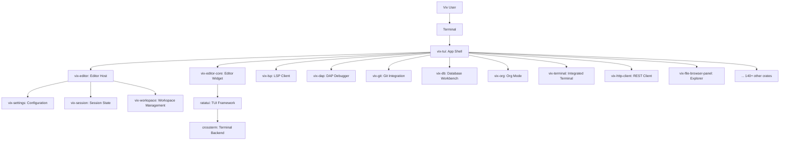

## Workspace Structure

```
vix/
├── Cargo.toml                    # Root workspace manifest
├── AGENTS.md                     # Contribution guidelines
├── plan.md                       # Improvement roadmap
├── tasks.md                      # Detailed task checklist
├── spec/                         # Cross-cutting specifications
│   ├── ci/                       # CI/CD specs
│   ├── packaging/                # Packaging specs
│   └── ...
├── tui/                          # Main app shell (vix-tui package)
│   ├── Cargo.toml
│   ├── src/
│   │   ├── main.rs               # Entry point
│   │   ├── app.rs                # App state and logic
│   │   ├── app/*.rs              # Feature modules (git, lsp, org, etc.)
│   │   ├── ui.rs                 # UI rendering
│   │   └── ui/*.rs               # UI components
│   ├── examples/                 # Cargo examples
│   ├── benches/                  # Benchmarks
│   └── tests/                    # Integration tests
├── crates/                       # 147 feature crates (vix-*)
│   ├── vix-editor/               # Editor host
│   │   ├── Cargo.toml
│   │   ├── src/
│   │   └── spec/
│   ├── vix-editor-core/          # Core editor widget
│   ├── vix-lsp/                   # LSP client
│   ├── vix-lsp-core/             # LSP protocol types
│   ├── vix-dap/                   # DAP debugger
│   ├── vix-git/                   # Git integration
│   ├── vix-db/                    # Database workbench
│   ├── vix-org/                   # Org mode
│   ├── vix-terminal/              # Integrated terminal
│   ├── vix-http-client/           # REST client
│   ├── vix-file-browser-panel/   # File explorer
│   └── ... (130+ more)
├── gui/                          # Desktop GUI frontends
│   ├── Cargo.toml
│   ├── vix-gpui/
│   ├── vix-egui/
│   ├── vix-iced/
│   ├── vix-slint/
│   ├── vix-gtk4/
│   ├── vix-bui/
│   └── vix-zgui/
├── fuzz/                         # Fuzz targets
├── scripts/                      # Build and check scripts
└── docs/                         # User documentation
```

## App Shell Architecture

The **App shell** (`tui/`) is the central coordinator that ties everything together:

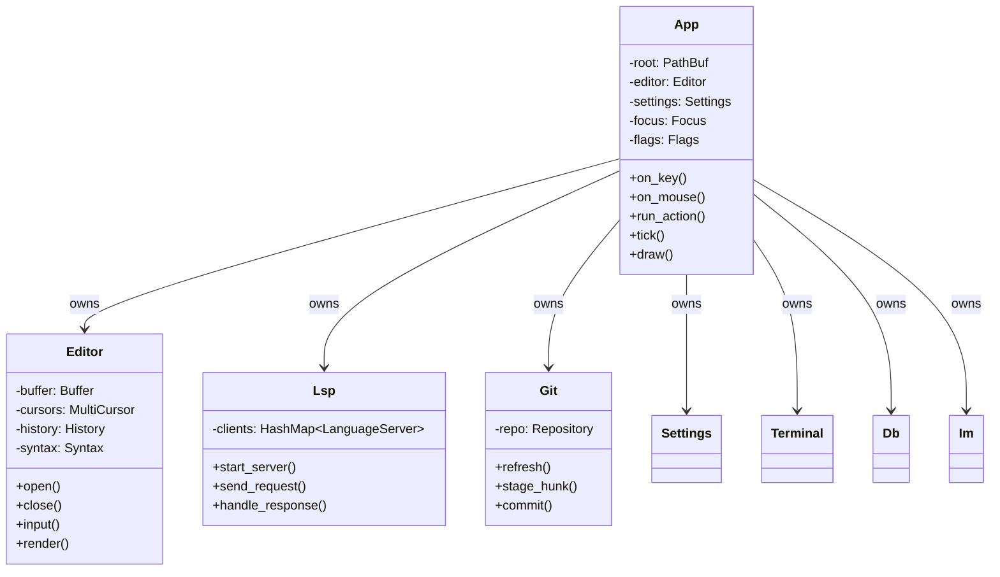

### Key App Components

| File | Purpose |
|------|---------|
| `tui/src/main.rs` | Entry point, terminal setup, event loop |
| `tui/src/app.rs` | Main App struct, key/mouse handling, action dispatch |
| `tui/src/app/git.rs` | Git integration logic |
| `tui/src/app/lsp_dap.rs` | LSP and DAP coordination |
| `tui/src/app/cowork.rs` | Real-time collaboration |
| `tui/src/app/remote_session.rs` | Remote editing over SSH |
| `tui/src/ui.rs` | Main UI rendering |
| `tui/src/ui/*.rs` | UI components (panels, overlays, etc.) |

## Editor Architecture

The editor is split across multiple crates:

```mermaid
erDiagram
    EditorHost ||--o{ EditorWidget : "uses"
    EditorHost ||--o{ Buffer : "owns"
    EditorHost ||--o{ History : "owns"
    EditorHost ||--o{ Syntax : "owns"
    
    EditorHost [label="vix-editor\n Editor Host"]
    EditorWidget [label="vix-editor-core\n Editor Widget"]
    Buffer [label="vix-fileops\n Buffer Management"]
    History [label="vix-undo-store\n Undo History"]
    Syntax [label="tree-sitter\n Syntax Parsing"]
```

### Editor Core Components

| Crate | Purpose |
|-------|---------|
| `vix-editor` | Editor host, tab management, split panes |
| `vix-editor-core` | Core editor widget, buffer, cursor, rendering |
| `vix-editorconfig` | EditorConfig file support |
| `vix-undo-store` | Persistent undo tree with branching |
| `vix-fileops` | File operations (read, write, watch) |
| `vix-encoding` | Character encoding handling |
| `vix-syntax` | Syntax highlighting (Tree-sitter) |

## Feature Crate Categories

### Code Intelligence

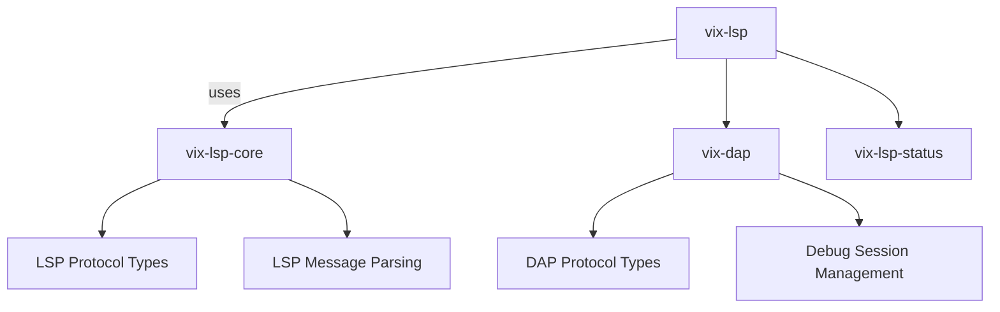

| Crate | Description |
|-------|-------------|
| `vix-lsp` | LSP client implementation |
| `vix-lsp-core` | LSP protocol types and message parsing |
| `vix-dap` | Debug Adapter Protocol client |
| `vix-lsp-status` | LSP status bar indicators |

### Version Control

| Crate | Description |
|-------|-------------|
| `vix-git` | Git integration (status, diff, stage, commit) |
| `vix-git-graph` | Interactive commit graph visualization |
| `vix-review` | Code review with side-by-side diff |
| `vix-conflict-tool` | Merge conflict resolution |

### Data & Documents

| Crate | Description |
|-------|-------------|
| `vix-db` | Database workbench (SQLite, PostgreSQL, MySQL) |
| `vix-edit-table` | CSV/TSV table editing |
| `vix-edit-sql` | SQL file editing with syntax awareness |
| `vix-edit-value` | JSON/YAML/TOML editing |
| `vix-edit-outline` | Outline/structural editing |
| `vix-edit-bytes` | Hex dump editing |
| `vix-large-file` | Large file viewer (multi-GB files) |
| `vix-markdown-preview` | Markdown preview rendering |

### Org Mode

| Crate | Description |
|-------|-------------|
| `vix-org` | Core Org mode parsing and editing |
| `vix-org-table` | Org table editing with formulas |
| `vix-org-capture` | Org capture templates |
| `vix-org-contacts` | Org contacts management |
| `vix-roam` | Org-roam with backlinks |
| `vix-column-view` | Column View for Org and file browser |

### Projects & Tools

| Crate | Description |
|-------|-------------|
| `vix-project-env` | Project environment detection (direnv, mise, venv) |
| `vix-tasks` | Task runner (npm, make, etc.) |
| `vix-terminal` | Integrated terminal emulator |
| `vix-http-client` | REST client for `.http` files |
| `vix-oci` | Open Container Initiative support |
| `vix-oci-panel` | Container management UI |

### Collaboration

| Crate | Description |
|-------|-------------|
| `vix-cowork` | Real-time collaborative editing |
| `vix-cowork-net` | Cowork network protocol |
| `vix-im` | Instant messaging (IRC, Matrix) |
| `vix-im-panel` | IM UI panel |
| `vix-matrix-protocol` | Matrix protocol support |
| `vix-im-irc` | IRC client implementation |

### AI & Assistants

| Crate | Description |
|-------|-------------|
| `vix-ai-core` | AI provider abstraction |
| `vix-ai-panel` | AI chat panel UI |
| `vix-ai-diff` | AI-assisted diff review |
| `vix-acp` | Agent Client Protocol client |
| `vix-mcp-server` | Model Context Protocol server |

### UI & Rendering

| Crate | Description |
|-------|-------------|
| `vix-menu` | Menu bar and context menus |
| `vix-palette` | Command palette |
| `vix-status-bar-panel` | Status bar |
| `vix-bottom-dock` | Bottom dock area |
| `vix-left-dock` | Left dock (file browser) |
| `vix-right-dock` | Right dock area |
| `vix-welcome-panel` | Welcome screen |
| `vix-theme` | Theme loading and management |
| `vix-theme-model` | Theme data model |
| `vix-theme-editor-panel` | Theme editor UI |

### Settings & State

| Crate | Description |
|-------|-------------|
| `vix-settings` | Configuration management |
| `vix-settings-bundle` | Bundled settings presets |
| `vix-session` | Session state management |
| `vix-workspace` | Workspace state management |
| `vix-keymap-model` | Keymap definitions |
| `vix-keybindings` | Keybinding registry |
| `vix-snippets` | Snippet management |
| `vix-script` | Rhai scripting |
| `vix-macros` | Keyboard macro recording |

### File Browser & Navigation

| Crate | Description |
|-------|-------------|
| `vix-file-browser-panel` | File explorer UI |
| `vix-file-information-panel` | File info display |
| `vix-workspace-dashboard-panel` | Workspace dashboard |
| `vix-text-information-panel` | Text info display |
| `vix-tags` | Tag management |
| `vix-todo-tree` | TODO tree |
| `vix-workspace-search` | Workspace search |
| `vix-find-panel` | Find/replace UI |

### Utilities

| Crate | Description |
|-------|-------------|
| `vix-i18n` | Internationalization |
| `vix-locale-model` | Locale management |
| `vix-clipboard` | Clipboard access |
| `vix-authority` | Authority abstraction (local, SSH, containers) |
| `vix-byte-size` | Byte size formatting |
| `vix-civil-date` | Civil date handling |
| `vix-time-zone-model` | Time zone management |
| `vix-uuid-tool` | UUID generation |
| `vix-base64-tool` | Base64 encoding/decoding |
| `vix-jwt-tool` | JWT encoding/decoding |
| `vix-qr-tool` | QR code generation |
| `vix-calendar-panel` | Calendar panel |
| `vix-clock-panel` | Clock panel |
| `vix-system-information-panel` | System info display |
| `vix-vcard-panel` | vCard display |
| `vix-vcard-parser` | vCard parsing |
| `vix-fhir` | FHIR support |
| `vix-hl7` | HL7 v2 support |

## Desktop GUI Architecture

Vix supports 8 desktop GUI frontends, each wrapping the same App shell:

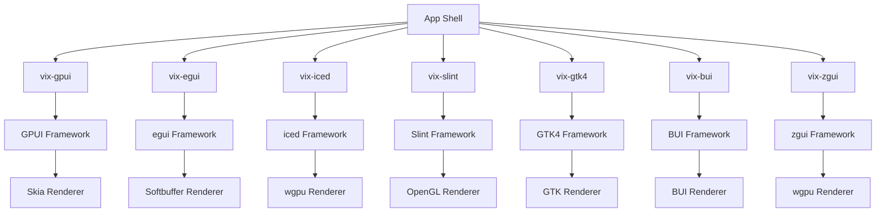

| Frontend | Framework | License | Notes |
|----------|-----------|---------|-------|
| `vix-gpui` | GPUI | MIT/Apache-2.0 | GPU-accelerated, native menu bar |
| `vix-egui` | egui | MIT/Apache-2.0 | Immediate mode, simple |
| `vix-iced` | iced | MIT/Apache-2.0 | Elm-style, CSS styling |
| `vix-slint` | Slint | GPL-3.0-only | Declarative, OpenGL |
| `vui-gtk4` | GTK4 | LGPL | Native GTK integration |
| `vix-bui` | BUI | GPL-3.0-only | Blender's UI toolkit |
| `vix-zgui` | zgui | Apache-2.0 | Reactive, CSS, wgpu |

All frontends:
- Share the same `App` shell from `tui/`
- Use the same key handling, action dispatch, and state management
- Render using the framework's capabilities
- Support the same features as the TUI version

## Data Flow

### Key Press Flow

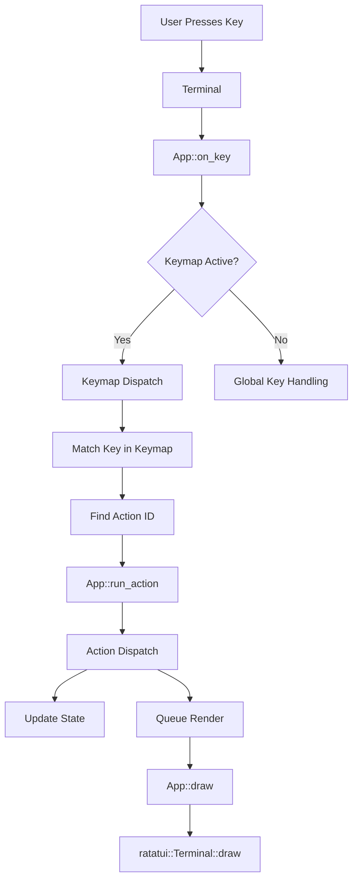

### LSP Request Flow

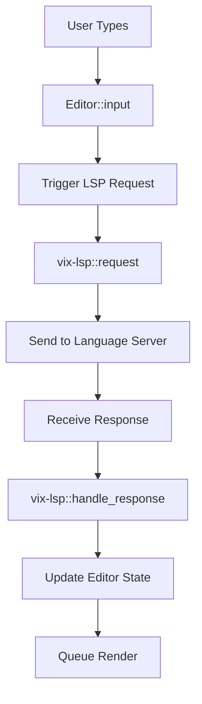

### Git Operation Flow

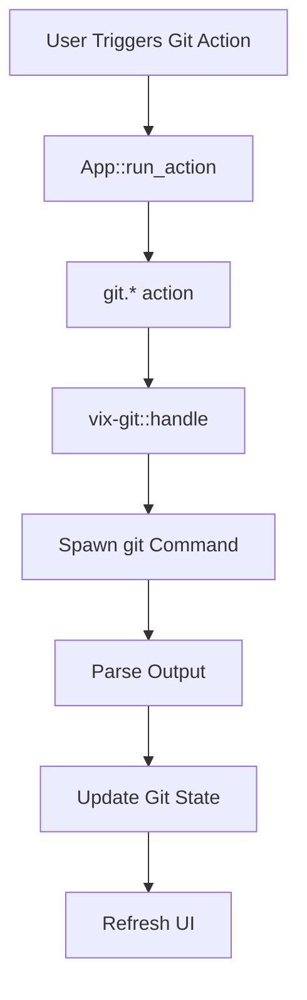

## Internationalization (i18n)

Vix uses a robust i18n system:

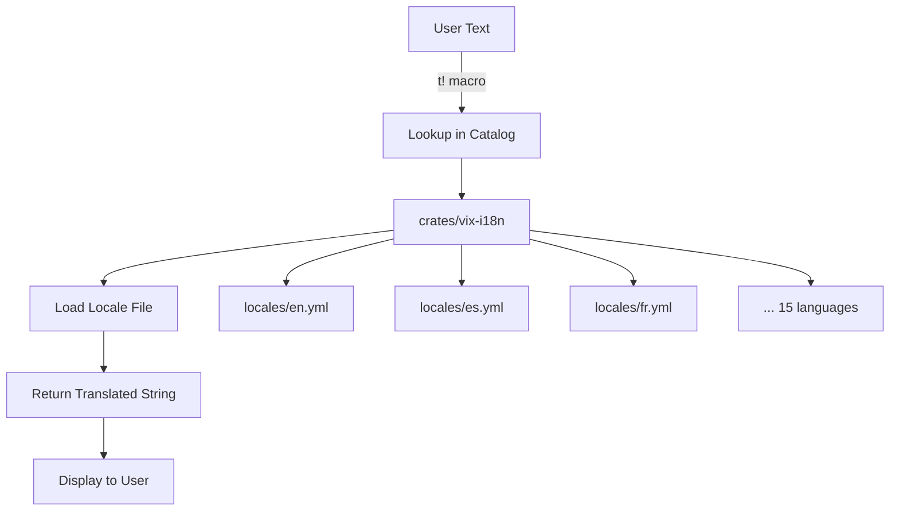

**Supported Languages:**
- English (en)
- Spanish (es)
- French (fr)
- German (de)
- Welsh (cy)
- Irish (ga)
- Scottish Gaelic (gd)
- Polish (pl)
- Portuguese (pt)
- Russian (ru)
- Arabic (ar)
- Hindi (hi)
- Bengali (bn)
- Chinese (zh)
- Japanese (ja)

## Settings System

Vix uses a hierarchical settings system:

```mermaid
erDiagram
    Settings ||--o{ UserSettings : "extends"
    Settings ||--o{ WorkspaceSettings : "extends"
    Settings ||--o{ ProjectSettings : "extends"
    
    Settings [label="vix-settings\n Settings"]
    UserSettings [label="~/.config/vix/config.toml"]
    WorkspaceSettings [label="Per-workspace overrides"]
    ProjectSettings [label=".vix/config.toml"]
```

Settings are loaded in this order (later overrides earlier):
1. Built-in defaults
2. User settings (`~/.config/vix/config.toml`)
3. Workspace settings (per-workspace)
4. Project settings (`.vix/config.toml`)

## Theme System

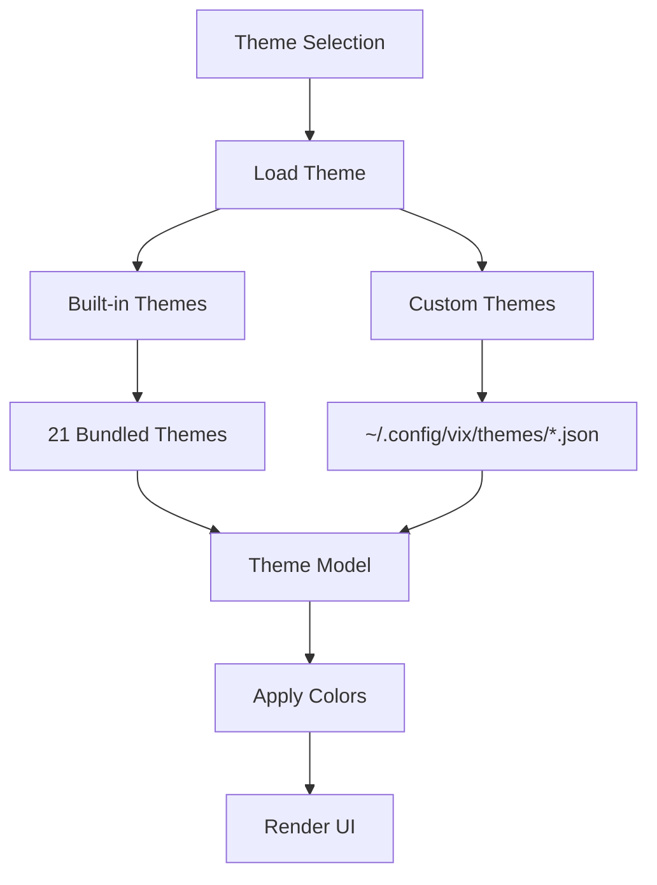

**Bundled Themes:**
- Default (light/dark variants)
- High contrast themes
- Popular color schemes (Catppuccin, etc.)

## Keymap System

Vix supports 14 keymaps:

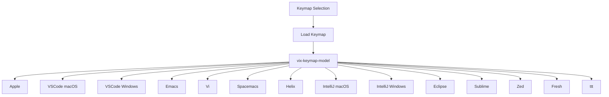

## Performance Architecture

Vix is designed for performance:

### Background Processing

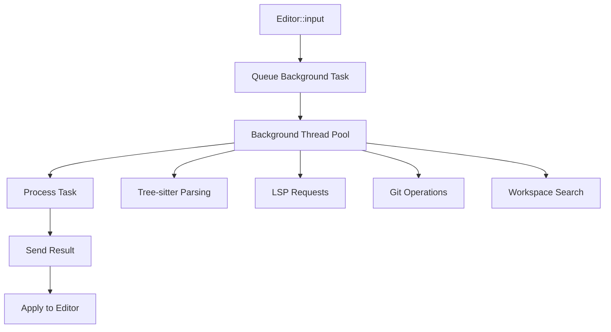

### Lazy Loading

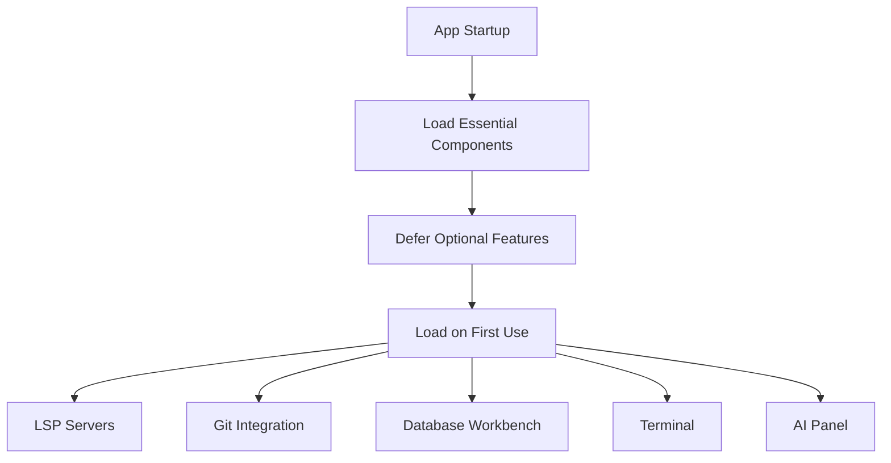

### Caching

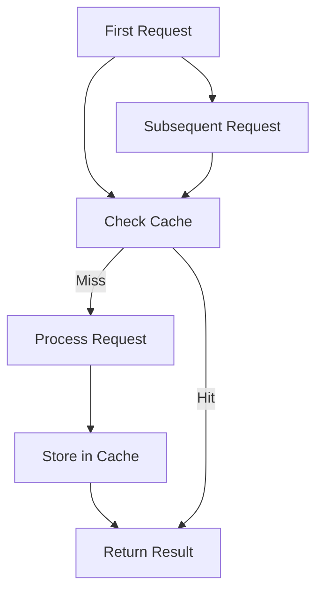

## Security Architecture

Vix takes security seriously:

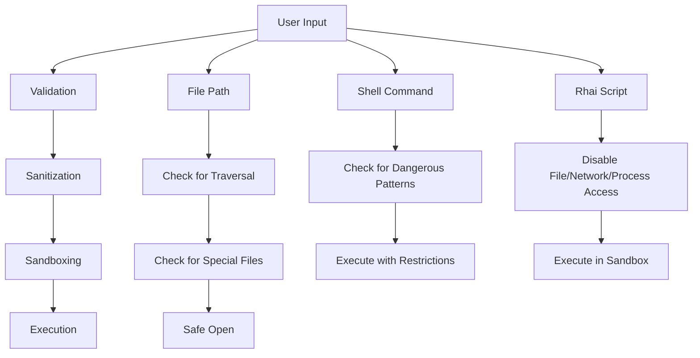

### Security Features

- **Zero `unsafe` Rust**: No unsafe code anywhere in the codebase
- **Sandboxed scripts**: Rhai scripts have no file/network/process access
- **Workspace trust**: Project scripts run only after explicit trust
- **Keyring integration**: Secrets stored in native credential stores
- **Input validation**: All external inputs are validated
- **Path sanitization**: Prevents directory traversal attacks
- **Command sanitization**: Prevents shell injection attacks

## Testing Architecture

Vix has comprehensive testing:

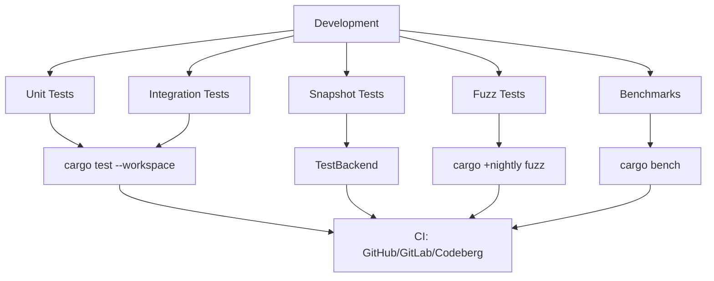

### Test Layers

| Layer | Framework | Purpose |
|-------|-----------|---------|
| Unit Tests | Rust `#[test]` | Test individual functions |
| Integration Tests | ratatui `TestBackend` | Test component interactions |
| Snapshot Tests | insta | Test UI rendering |
| Fuzz Tests | cargo-fuzz | Test parser edge cases |
| Benchmarks | Criterion | Test performance |

## CI/CD Architecture

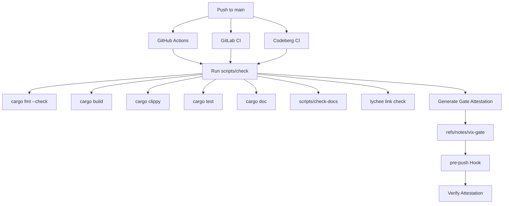

## Summary

Vix's architecture is designed for:

1. **Modularity**: Each feature is isolated in its own crate
2. **Maintainability**: Clear boundaries and specifications
3. **Extensibility**: Easy to add new features
4. **Performance**: Background processing, lazy loading, caching
5. **Security**: Sandboxing, validation, zero unsafe
6. **Internationalization**: Full support for 15 languages
7. **Accessibility**: High contrast, keyboard-only, screen reader friendly

The architecture enables Vix to be:
- **Fast**: Native binary, optimized rendering
- **Reliable**: Comprehensive testing, zero unsafe
- **Flexible**: Multiple keymaps, themes, configurations
- **Extensible**: Scripting, plugins (future), customization
- **Portable**: Works anywhere Rust runs

---

## Next Steps

If you're new to Vix's codebase, here are some good next steps:

1. **Read AGENTS.md** - Detailed conventions and workflow
2. **Read agents/workflow.md** - Spec-driven development guide
3. **Explore the crates** - Each crate has its own `spec/index.md`
4. **Run the examples** - `cargo run --example list_commands`
5. **Check the docs** - `docs/` has user-facing documentation
6. **Join the community** - Ask questions in GitHub Discussions

---

## Resources

- [AGENTS.md](../AGENTS.md) - Contribution guidelines
- [agents/workflow.md](../agents/workflow.md) - Development workflow
- [plan.md](../plan.md) - Improvement roadmap
- [tasks.md](../tasks.md) - Detailed tasks
- [docs/](.) - User documentation
- [spec/](../spec/) - Specifications
