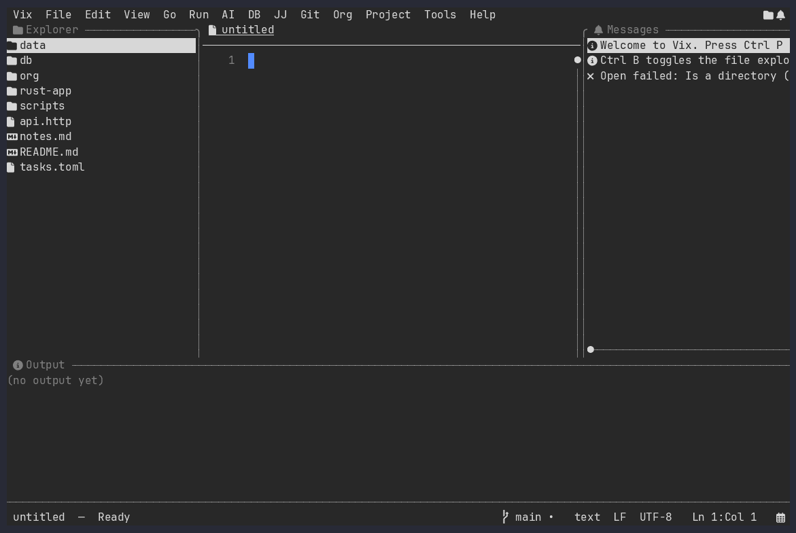

# Vix IDE™

[](https://github.com/vixide/vix/actions/workflows/ci.yml)
[](https://crates.io/crates/vix-tui)
[](LICENSE)

**Vix is a terminal text editor and IDE, written in Rust, that you can use
with the keys you already know.** Save is `Ctrl+S`, find is `Ctrl+F`, and
everything else is in a menu bar or the `Ctrl+P` command palette — no modes
to learn first (a Vi keymap is there if you want one). A language-server
client, a debugger, Git and Jujutsu, an Org-mode suite, a database workbench
and an integrated terminal are built in, so there is no plugin setup before
it is useful.



Website: <https://vixide.github.io/> · Documentation:
<https://vixide.github.io/vix/> · New here? Read
[Getting Started](docs/getting-started/index.md).

## Why Vix

- **Familiar keys, no modes by default.** Ctrl/Cmd shortcuts, a real menu bar
  (Vix File Edit View Go Run AI DB JJ Git Org Project Tools Help), mouse
  support, and `F1` for every shortcut. Ten keymaps — Apple (the default),
  VS Code (macOS/Windows), Emacs, Vi, Spacemacs, IntelliJ (macOS/Windows),
  Eclipse and Sublime Text — switchable live from **View → Keymap**.
- **An IDE, not just an editor.** Language Server Protocol, a DAP debugger,
  Tree-sitter highlighting, Git (hunk staging, blame, conflict resolver) and
  Jujutsu, a test runner, project tasks and an integrated terminal ship in
  one binary.
- **Things other editors leave to plugins.** An Org-mode suite with Org-roam,
  a SQLite/PostgreSQL/MySQL workbench, an HTTP client, table/JSON/YAML/hex
  edit surfaces, and a persistent, branching undo tree.
- **Careful by default.** `unsafe` code is forbidden in every crate. Rhai
  scripts get no file, network or process access, and a project's own scripts
  run only after you trust that workspace. The DB workbench opens connections
  read-only. A [minimal build](#install) leaves out every network, shell and
  external-program feature for locked-down machines.
- **Yours to adjust.** 20 bundled themes plus your own, a UI fully translated
  into 15 languages, snippets, macros, and Rhai scripts that add commands and
  key bindings without a rebuild.
- **Terminal or desktop.** The same editor also runs in a native window via
  experimental [desktop GUIs](#desktop-guis).

Coming from another editor? See the pages for
[Vim](docs/for-vim-users/index.md),
[Emacs](docs/for-emacs-users/index.md),
[Spacemacs](docs/for-spacemacs-users/index.md),
[Helix](docs/for-helix-users/index.md),
[VS Code](docs/for-visual-studio-code-users/index.md),
[IntelliJ](docs/for-intellij-users/index.md),
[Eclipse](docs/for-eclipse-users/index.md) and
[Sublime Text](docs/for-sublime-users/index.md) users, and the
[feature comparison](docs/comparison/index.md) with Vim, Helix, Micro and Zed.

## Install

The command is `vix` however you install it.

```sh
# macOS or Linux, Homebrew
brew install vixide/homebrew-tap/vix-tui

# macOS or Linux, installer script
curl --proto '=https' --tlsv1.2 -LsSf https://github.com/vixide/vix/releases/latest/download/vix-tui-installer.sh | sh

# Any platform with npm
npm install -g @vixide/vix

# Any platform with a Rust toolchain (1.96+)
cargo install vix-tui
```

On Linux, every release also has native packages (`.deb`, `.rpm`, Arch
`.pkg.tar.zst`) for x86_64 and aarch64. Download yours from the
[latest release](https://github.com/vixide/vix/releases/latest), then for
example `sudo apt install ./vix-tui_*_amd64.deb` or
`sudo dnf install ./vix-tui-*.x86_64.rpm`.

On Windows, use PowerShell:

```powershell
powershell -ExecutionPolicy Bypass -c "irm https://github.com/vixide/vix/releases/latest/download/vix-tui-installer.ps1 | iex"
```

Prebuilt archives (`.tar.xz`, `.zip`, `.msi`) are attached to every
[GitHub Release](https://github.com/vixide/vix/releases), along with a
**minimal build** (`vix-minimal-<target>`): no DB workbench, scripting,
terminal, HTTP client, AI, Git/Jujutsu, language servers, debug adapters or
syntax highlighting; no TLS stack, no network connections, and Vix starts no
other program. See [Getting Started](docs/getting-started/index.md) for every
option, and use a [Nerd Font](https://www.nerdfonts.com/) for the best-looking
icons (Vix falls back to plain characters without one).

## Your first minute

```sh
vix                     # open the current directory
vix src/main.rs:42:7    # open a file at line 42, column 7
```

| Keys | Does |
| --- | --- |
| `Esc` | Close the welcome screen (reopen it from **Help → Welcome…**) |
| `Ctrl+P` | Command palette: fuzzy-find files; type `>` for commands, `@` for symbols, `:` for a line |
| `Ctrl+B` / `Ctrl+E` | Show or hide the file explorer / focus it |
| `Ctrl+O`, `Ctrl+S` | Open, save |
| `Ctrl+F`, `Ctrl+R`, `Ctrl+Shift+F` | Find, find and replace, search the workspace |
| `Ctrl+Z`, `Ctrl+Shift+Z` | Undo, redo |
| `F1` | Every shortcut in your current keymap, searchable |
| `Ctrl+Q` | Quit (Vix asks before discarding unsaved work) |

These are the default Apple keymap's bindings; on macOS `Command` works
wherever `Control` does. Every action is also in a menu, whatever the keymap.

## Features

**Editing.** Tabs and split panes; multi-cursor and column editing; soft wrap,
bracket matching, relative line numbers, indent guides, rainbow brackets,
sticky scroll and a minimap; surround, align, increment/toggle, transpose,
fill paragraph, comment toggle (`Ctrl+/`) and comment banners; Emmet;
snippets; clipboard history; sort/dedupe/case/line-ending transforms;
format-on-save, auto-save and auto-reload; an undo tree that is saved and
restored when you reopen a file.

**Finding your way.** Command palette with file, command, buffer, line and
symbol modes; incremental find and replace with smart-case, whole-word, regex
and capture groups; workspace search and replace; go to definition (`F12`);
leap-style jump labels; structural selection; position history
(`Alt+Left`/`Alt+Right`); a file explorer with preview tabs and file
operations; Zen mode and a breadcrumb bar.

**Code intelligence.** LSP diagnostics, hover, completion, references, call
hierarchy, rename, code actions, code lens and inlay hints; a DAP debugger
with breakpoints, stepping, call stack, variables, watches and a REPL; a test
runner with jump-to-failure; a TODO finder.

**Version control.** Git status, diff, blame, stage/unstage/revert per hunk,
branches, stash, amend and a merge-conflict resolver; a Jujutsu menu for
log, bookmarks, new/describe/commit, squash, rebase, undo, and push/fetch.

**Projects and tools.** Per-project-type build/test/run commands; tasks
discovered from npm/yarn/pnpm/bun, Deno, Composer, just, go-task, Rake and
Make; test-at-point; an integrated terminal; an HTTP client for `.http`
files; an AI menu that runs the assistant CLI of your choice on a selection.

**Data and documents.** A database workbench for SQLite, PostgreSQL and MySQL
with embedded drivers, a schema browser, autocomplete, a filterable result
grid, transactions, SSH tunnels and an ER diagram; edit a buffer as a CSV/TSV
table, a JSON/YAML tree, a hex dump or a folding outline; Markdown preview;
image viewing on graphics-capable terminals.

**Org mode.** Headlines, TODO cycling, checkboxes, folding, an agenda, a table
editor with `TBLFM` formulas, Column View, export to Markdown/HTML, contacts,
and Org-roam with link completion, dailies and a live backlinks panel.

**Look and language.** 20 bundled themes (including high-contrast and
Catppuccin) and a theme editor; `theme = "auto"` follows your terminal's
light or dark background; the UI is translated into 15 languages.

The full list, with every key and setting, is in [the docs](docs/index.md):
start with the [menus](docs/menus/index.md), the
[action reference](docs/reference/actions.md) and
[configuration](docs/configuration/index.md).

## Desktop GUIs

The same editor — every panel, overlay and dock — also runs in a native window
on macOS, Windows and Linux. Four front ends ship with each release,
installed like `vix-tui` under their own names (for example
`brew install vixide/homebrew-tap/vix-gpui`): `vix-gpui` (GPUI), `vix-egui`
(egui), `vix-iced` (iced) and `vix-slint` (Slint, GPL-3.0-only). A fifth,
`vix-gtk4` (GTK 4), builds from source. They are **experimental**, built side
by side so the toolkits can be compared; see
[`gui/spec/index.md`](gui/spec/index.md).

## Configuration

Settings are TOML in the platform configuration directory (for example
`~/.config/vix/config.toml` on Linux); custom themes go in
`~/.config/vix/themes/*.json`. See
[`docs/configuration/index.md`](docs/configuration/index.md) for every key and
[`tui/examples/config/`](tui/examples/config/) for an annotated example.
Command-line flags — `--locale`, `--diff OLD NEW`, `vix -` to read stdin,
`--version --json` — are in [`docs/cli/index.md`](docs/cli/index.md).

## Build from source

Needs a Rust toolchain, 1.96 or newer.

```sh
git clone https://github.com/vixide/vix.git
cd vix
cargo run                                            # open the editor here
cargo build --release                                # binary at target/release/vix
cargo build --release --features syntax-all          # with every Tree-sitter grammar
cargo build --profile minimal --no-default-features  # the minimal build
```

Tree-sitter grammars are compiled C parsers, so the default build includes a
lean set (Rust, Markdown, JSON, TOML); see
[`spec/cargo-features/index.md`](spec/cargo-features/index.md) for every
feature.

## Contributing

Vix is a Cargo workspace: a thin app shell (the `vix-tui` package in `tui/`)
over about 120 focused `vix-*` crates in `crates/`, with the desktop GUIs in
`gui/`. Development is specification-driven — each crate's spec at
`crates/<crate>/spec/index.md` is the source of truth. Start with
[`AGENTS.md`](AGENTS.md) (conventions, workflow and crate map, for humans and
AI agents alike) and
[`docs/contributing-workflow.md`](docs/contributing-workflow.md).

```sh
cargo test
cargo clippy --workspace --all-targets -- -D warnings
scripts/check    # the full local gate that CI runs
```

Runnable examples live in [`tui/examples/`](tui/examples/) — for instance
`cargo run --example headless_edit` (open, edit and save a file with no UI)
and `cargo run --example list_commands` (print every command). The demo GIFs
are [VHS](https://github.com/charmbracelet/vhs) scripts in
[`docs/demos/`](docs/demos/), rendered by `scripts/render-demos.sh`.

## License

Vix's source is licensed under any of Apache-2.0, BSD-3-Clause, MIT,
GPL-2.0-only, or GPL-3.0-only, at your option; each distributed binary
declares the subset its linked dependencies allow. See [`LICENSE`](LICENSE).

## Security

Found a vulnerability? See [`SECURITY.md`](SECURITY.md) for how to
report it privately, rather than opening a public issue.

## AI Statement

Vix is developed with substantial AI assistance. See
[`AI_STATEMENT.md`](AI_STATEMENT.md) for what that means: how AI-authored
work is disclosed, what bar it has to clear, and what an AI agent is (and
isn't) authorized to do here without asking first — currently `cargo
publish` and judging that a specific release is ready, nothing beyond that.

---

Vix™ and Vix IDE™ are trademarks.
